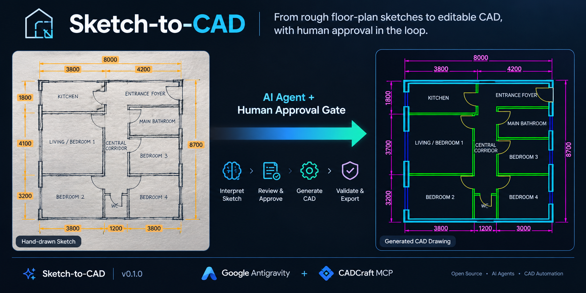
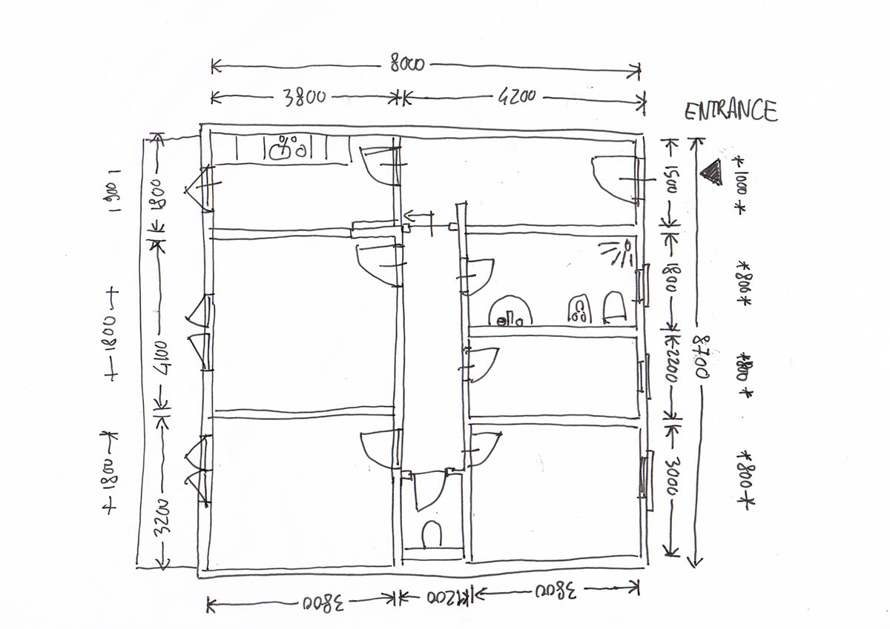
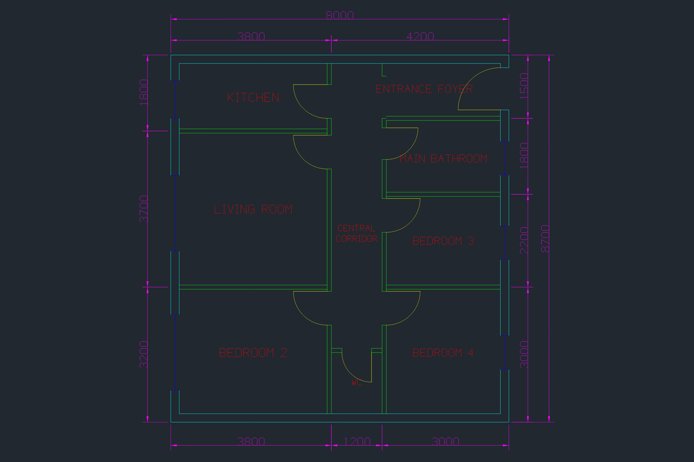
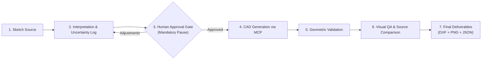

# Sketch-to-CAD

**From rough floor-plan sketches to editable CAD, with human approval in the loop.**

An open-source AI agent skill that transforms hand-drawn residential floor-plan sketches into reviewable, layered CAD drawings (DXF + PNG) through structured interpretation, explicit user approval, and geometry validation.

---

[](https://github.com/hasnizihar/sketch-to-cad/releases)
[](LICENSE)
[](docs/installation.md)
[](docs/cadcraft-mcp-setup.md)
[](https://github.com/hasnizihar/sketch-to-cad/stargazers)

<p align="center">
  
</p>

[Quick Start](#quick-start) • [How It Works](#how-it-works) • [Demonstration](#before-and-after-demonstration) • [Documentation](docs/) • [Report an Issue](https://github.com/hasnizihar/sketch-to-cad/issues)

---

## Before-and-After Demonstration

| Input: Hand-Drawn Sketch (Before) | Output: Verified CAD Floor Plan (After) |
| :---: | :---: |
|  |  |
| *Raw sketch with handwritten dimensions & conflicting sums* | *Layered vector CAD with sealed jambs & readable dimensions* |

### What Sketch-to-CAD Reconciles

- **Dimension Conflicts**: The sketch’s left-hand chain ($1800 + 4100 + 3200 = 9100\text{ mm}$) conflicted with the right-hand depth ($8700\text{ mm}$). Through the **User Approval Gate**, the agent detected the discrepancy, paused drafting, and obtained human confirmation to lock the rectangular footprint to $8000 \times 8700\text{ mm}$ with a $3700\text{ mm}$ middle room.
- **Sealed Wall Cavities**: Converts rough lines into clean $200\text{ mm}$ exterior walls (`A-WALL-EXTR`) and $100\text{ mm}$ interior partitions (`A-WALL-INTR`) with transverse jamb end-caps sealing every door and window cutout.
- **Orientation Reconciliation**: Verifies the main entrance on the East exterior wall into the Foyer, with inward swing geometry matching the sketch.
- **Circulation & Label Clearance**: Formats corridor labels as multi-line stacked text (`CENTRAL` / `CORRIDOR`) to eliminate line collisions in narrow circulation spaces.
- **Readable Architectural Dimensions**: Applies a dedicated dimension style (`textHeight: 180`, `arrowSize: 140`, $90^\circ$ vertical rotation) so numeric annotations are crisp and legible.

---

## Why Sketch-to-CAD?

Converting a rough sketch into a production-ready CAD drawing is deceptively difficult. Hand-drawn sketches frequently have:
- **Conflicting arithmetic** (individual room sums rarely match overall building dimensions).
- **Ambiguous handwriting** and missing opening dimensions.
- **Unclosed wall perimeters** and missing jamb details.

Fully autonomous AI generators often "hallucinate" dimensions silently or produce un-editable raster lines.

**Sketch-to-CAD takes a different approach**:
1. **It classifies information** into `explicit` (written), `estimated` (proportional), and `inferred` (architectural standards).
2. **It logs all uncertainties** in a structured intermediate model ([`floor-plan-model.json`](skills/sketch-to-cad/schemas/floor-plan-model.json)).
3. **It pauses at an explicit Approval Gate**: CAD drafting **cannot begin** without your confirmation.
4. **It runs dual quality checks**: Automated geometric verification followed by visual raster inspection against the source sketch.

---

## Architecture: Skill vs. Environment vs. CAD Backend

Sketch-to-CAD is an **AI agent skill and workflow**, not a standalone desktop application. It operates through the following division of responsibility:

| Component | What It Does | Source |
| :--- | :--- | :--- |
| **Sketch-to-CAD** *(This Repository)* | Agent instructions, prompt workflows, JSON schema, and quality gates | Open-source (`skills/sketch-to-cad/`) |
| **Google Antigravity** | AI agent host environment, LLM orchestration, and workspace access | Agent runtime |
| **CADCraft CLI / MCP** | Headless drafting engine executing lines, arcs, layers, and DXF/PNG export | Proprietary CAD backend (MCP over stdio) |
| **Human User** | Reviews assumptions, approves corrections, and verifies output | Human in the loop |

> [!IMPORTANT]
> **Dependency Boundary**: Installing this repository adds the skill to your Antigravity workspace. It does **not** install or bundle CADCraft or Antigravity. Both must be installed on your machine.

---

## Key Capabilities (v0.1.0)

- **Sketch Decomposition**: Extracts building footprints, wall graphs, room polygons, doors, windows, and handwritten dimensions.
- **Dimension Classification**: Flags measurements as `explicit`, `estimated`, or `inferred` to preserve source truth.
- **Uncertainty Logging**: Automatically captures discrepancies (e.g., room chain $\ne$ envelope) in an actionable review table.
- **Mandatory User Approval Gate**: Never generates CAD geometry until the user confirms or corrects the proposed model.
- **AIA Layer Architecture**: Distributes vector entities across standard AIA layers (`A-WALL-EXTR`, `A-WALL-INTR`, `A-DOOR`, `A-GLAZ`, `A-FURN`, `A-FIXT`, `A-STAIR`, `A-COLS`, `A-FLOR-FIN`, `A-ANNO-TEXT`, `A-ANNO-DIMS`).
- **Reusable Architectural Element Library**: 20 standardized 2D CAD blocks across furniture, sanitary fixtures, kitchen counters/hobs/sinks, structural columns, and straight/L-shaped stairs.
- **Floor Finishes & Tile Hatches**: Generates boundary perimeters and tile grid patterns (`ANSI37`/`NET`) on `A-FLOR-FIN` for bathrooms and wet areas.
- **Clean Segmented Openings**: Cuts walls at door/window jambs and seals double-wall cavities with transverse end-caps.
- **Architectural Dimension Scaling**: Applies scaled styles with rotated vertical chains for clear readability at standard zoom levels.
- **Multi-Format Export**: Delivers editable `.dxf`, visual `.png` preview, structured `.json` data model, and an acceptance report.

*Scope: Version 0.1.0 targets single-storey orthogonal residential floor plans.*

---

## How It Works: The 7-Stage Quality Gate



1. **Discover & Gather**: Agent inspects available CADCraft MCP tools and reads your sketch image.
2. **Interpret & Classify**: Decomposes walls, openings, and dimensions; catalogs all ambiguities into an Uncertainty Log.
3. **User Approval Gate**: Presents the structured proposal. **The agent halts and waits for your confirmation.**
4. **Deterministic CAD Generation**: Translates approved coordinates into CADCraft vector operations on AIA layers.
5. **Geometric Validation**: Queries drawing topology to confirm extents, layer allocations, and room centroid bounds.
6. **Visual QA & Source Comparison**: Renders a raster preview to inspect dimension readability, jamb closures, label clearances, and sketch alignment.
7. **Deliver Final Deliverables**: Exports the `.dxf` drawing, `.png` preview, `.json` model, and validation report.

*(For detailed stage-by-stage instructions, read [docs/workflow.md](docs/workflow.md).)*

---

## Quick Start

### 1. Prerequisites
- **OS**: Windows 10 / 11 (tested)
- **Agent Environment**: Google Antigravity IDE / Agent runtime
- **CAD Engine**: [CADCraft CLI](docs/cadcraft-mcp-setup.md) v0.8.0+ installed on your system
- **Shell**: Windows PowerShell 5.1+ or PowerShell 7+

### 2. Install the Skill
Clone this repository and run the PowerShell installer targeting your Antigravity workspace:

```powershell
# 1. Clone the repository
git clone https://github.com/hasnizihar/sketch-to-cad.git
cd sketch-to-cad

# 2. Preview installation (dry-run, no files modified):
.\scripts\install.ps1 -WorkspacePath "C:\Projects\MyArchitectureWorkspace" -DryRun

# 3. Install into your workspace:
.\scripts\install.ps1 -WorkspacePath "C:\Projects\MyArchitectureWorkspace"
```

### 3. Configure the CADCraft MCP Server
In your workspace, create or edit `.agents/mcp_config.json`:

```json
{
  "mcpServers": {
    "cadcraft": {
      "command": "C:\\Program Files\\CADCraft\\cadcraft-cli.exe",
      "args": ["mcp"]
    }
  }
}
```
*(Replace `"C:\\Program Files\\CADCraft\\cadcraft-cli.exe"` with the actual path to your `cadcraft-cli.exe`. See [docs/cadcraft-mcp-setup.md](docs/cadcraft-mcp-setup.md)).*

### 4. Run an Example Workflow
1. Place a residential floor-plan sketch (e.g., `sketch.jpg`) in your workspace.
2. In Antigravity, submit this prompt:
   > *"Interpret sketch.jpg using the sketch-to-cad skill. Extract the dimensions, classify uncertainties, build the floor-plan model, and show me the proposal. Stop after Phase 3 and wait for my approval before drafting."*
3. Review the proposed dimensions and Uncertainty Table.
4. Reply with your decision:
   > *"Approved. Proceed with Option A (8000mm depth, 3700mm middle room). Generate the CAD drawing."*
5. The agent generates and validates the drawing, delivering your editable CAD files.

---

## Output Deliverables

Each completed workflow produces six coordinated artifacts:

| Deliverable | Format | Description |
| :--- | :--- | :--- |
| **Master CAD Drawing** | `.dxf` | Layered 2D vector CAD drawing compatible with AutoCAD, CADCraft, LibreCAD, and QCAD. |
| **BIM Handoff Contract** | `.handoff.json` | Structured companion metadata adhering to [`bim-handoff.schema.json`](skills/sketch-to-cad/schemas/bim-handoff.schema.json) for 3D reconstruction in `dxf-to-3d-bim`. |
| **Architectural Reports & Schedules** | `.report.json`, `.report.md`, `.report.pdf` | Verified room areas (Shoelace), door/window schedules, element inventory, finish schedules, and uncertainty audit adhering to [`architectural-report.schema.json`](skills/sketch-to-cad/schemas/architectural-report.schema.json). |
| **Visual Preview** | `.png` | High-resolution raster preview for instant visual verification without CAD software. |
| **Floor Plan Model** | `.json` | Intermediate coordinate data model conforming to [`schemas/floor-plan-model.json`](skills/sketch-to-cad/schemas/floor-plan-model.json). |
| **Acceptance Report** | `.md` | Itemized audit report with PASSED, FAILED, and UNVERIFIED compliance notices. |

---

## Limitations & Safety Boundaries

Sketch-to-CAD v0.1.0 is an **experimental public preview**. Please note the following boundaries:

- **Orthogonal Geometry Only**: Supports 0° and 90° straight walls. Angled walls, circular curves, and freeform layouts are not supported.
- **Single-Storey Scope**: Multi-storey vertical alignment and stairwell continuity are deferred to future releases.
- **Human Disambiguation Required**: When handwritten sketch numbers conflict mathematically, the system requires user input rather than guessing.
- **Not Certified Engineering**: Outputs are preliminary drafting aids. Structural load-bearing capacity, shear walls, egress safety, and municipal building code compliance are **UNVERIFIED** and must be reviewed and stamped by a licensed architect or professional engineer.

*(Read [docs/limitations.md](docs/limitations.md) for full technical constraints).*

---

## Project Status & Roadmap

| Version | Status | Focus Areas |
| :--- | :---: | :--- |
| **v0.1.0** | **Current** | Core 7-stage workflow, user approval gate, CADCraft MCP integration, AIA layering, sealed jamb caps, visual QA gate, DXF/PNG exports. |
| **v0.2.0** | *Planned* | External-user installation testing, automated geometry regression test suite, multi-partition wall junction solver, automatic dimension tier spacing. |
| **v0.3.0** | *Planned* | Low-resolution & skewed photo perspective correction, improved OCR handwriting extraction, gross vs. net room area schedules. |
| **Future** | *Backlog* | Multi-storey floor plans with stairwell continuity, additional CAD backends (LibreCAD/FreeCAD), and IFC/BIM export. |

---

## Project Structure

```
sketch-to-cad/
├── README.md                          # Project landing page & documentation
├── LICENSE                            # MIT License
├── CONTRIBUTING.md                     # Contribution guidelines & approval gate rules
├── CHANGELOG.md                        # Version history & release notes
├── .gitignore                         # Excludes secrets, tokens, test artifacts, & local drawings
├── docs/
│   ├── assets/                        # Showcase images (before-sketch, after-cad)
│   ├── installation.md                # Detailed manual & automated setup guide
│   ├── cadcraft-mcp-setup.md          # CADCraft CLI MCP server configuration
│   ├── workflow.md                    # In-depth guide to the 7-stage quality gates
│   ├── troubleshooting.md             # Common errors, connection fixes & recovery
│   └── limitations.md                 # Technical boundaries & version roadmap
├── scripts/
│   ├── install.ps1                    # PowerShell installer with -DryRun support
│   ├── validate-skill.ps1             # Automated schema, links, & safety validator
│   ├── drawing_generator.py           # Deterministic CAD drafting & handoff engine
│   ├── element_library.py             # 20 standard residential CAD blocks
│   └── architectural_reports.py       # Schedules, quantities, & audit report engine
├── skills/
│   └── sketch-to-cad/                 # The reusable Antigravity skill
│       ├── SKILL.md                   # Master skill definition
│       ├── references/                # CADCraft schemas, element library, BIM handoff, reporting guide
│       ├── schemas/                   # JSON schemas (floor-plan-model, bim-handoff, architectural-report)
│       ├── workflows/                 # Stage-by-stage drafting, reporting & validation guides
│       └── examples/                  # Reference projects and fixtures
└── tests/
    ├── README.md                      # Test suite documentation (67 tests, 12 checks)
    ├── fixtures/                      # Validated floor-plan models and handoff JSON
    └── output/                        # DXF, PNG, handoff JSON, and report deliverables
```

---

## Contributing

Contributions, bug reports, and additional sketch test cases are welcome!
1. Check existing [Issues](https://github.com/hasnizihar/sketch-to-cad/issues).
2. Read [CONTRIBUTING.md](CONTRIBUTING.md) for workflow rules and code style.
3. Verify changes locally with the automated validator:
   ```powershell
   .\scripts\validate-skill.ps1
   ```
4. Submit a Pull Request.

---

## Troubleshooting & Support

- **MCP Connection Errors**: Ensure CADCraft CLI is installed and your path in `.agents/mcp_config.json` uses escaped backslashes (`\\`).
- **Command Not Found**: Verify that Antigravity was restarted after updating `.agents/mcp_config.json`.
- **Review Full Guide**: See [docs/troubleshooting.md](docs/troubleshooting.md) for solutions to common issues.
- **Ask a Question**: Open a discussion or report an issue on [GitHub Issues](https://github.com/hasnizihar/sketch-to-cad/issues).

---

## License

This project is licensed under the [MIT License](LICENSE).

---

> [!CAUTION]
> **Preliminary Drafting Notice**  
> Drawings generated by Sketch-to-CAD are conceptual drafting assistance tools. Structural integrity, shear load distribution, foundation engineering, fire safety, and municipal building code compliance are **strictly unverified**. All drawings must be reviewed and certified by a licensed design professional prior to construction.
