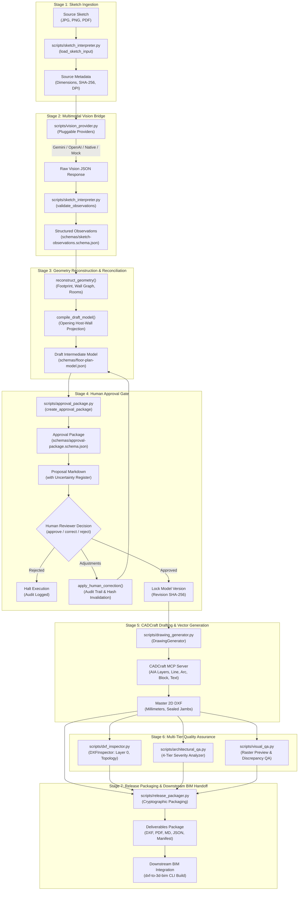
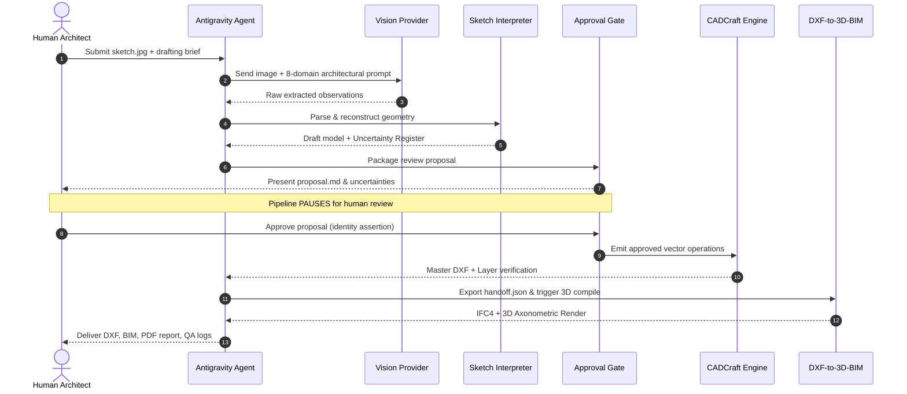

# System Architecture: Sketch-to-CAD

**Document Version:** 1.0.0  
**Target Runtime:** Google Antigravity Agent Runtime  
**Supported CAD Backend:** CADCraft CLI / MCP Server  
**Downstream Integration:** DXF-to-3D-BIM  

---

## 1. Architectural Philosophy & Core Tenets

Sketch-to-CAD is built around three architectural tenets:
1. **Decoupled Modularity**: Ingestion, visual interpretation, geometric reconstruction, drafting, validation, and release packaging are independent subsystems communicating via strict JSON Schemas (Draft-07).
2. **Defensive Provenance**: Data is never promoted to verified status without an explicit audit trail. Ground-truth benchmark data is isolated from inference execution.
3. **Mandatory Human-in-the-Loop Governance**: The system refuses to generate CAD vector entities until an authenticated human reviewer confirms or adjusts the interpreted coordinate model.

---

## 2. End-to-End Pipeline Data Flow

---

## 3. Subsystem Descriptions

### 3.1 Multimodal Vision Bridge (`scripts/vision_provider.py`)
The vision bridge decouples visual feature extraction from the drafting engine. It defines a uniform abstract base class `BaseVisionProvider`:
- **`GoogleGeminiVisionProvider`**: Connects to `gemini-2.5-flash` or `gemini-1.5-pro` via Google AI Studio API.
- **`OpenAIVisionProvider`**: Connects to `gpt-4o` via OpenAI REST API.
- **`AntigravityAgentVisionProvider`**: Agent-native execution using pre-recorded or live agent multimodal inspection.
- **`MockVisionProvider`**: Deterministic synthetic mock provider for automated regression testing without network access.

**Security & Sanitization**:
- `scripts/vision_config.py` enforces secret masking (`AIzaSy...****`) in all runtime logs and exception traces.
- Direct invocation without credentials immediately triggers a descriptive validation error rather than falling back silently to mock.

### 3.2 Geometry Reconstruction & Projection (`scripts/sketch_interpreter.py`)
Converts pixel-space bounding boxes and annotated dimensions into an orthogonal vector model:
- **Envelope Reconciliation**: Detects arithmetic mismatches between bounding box ratios and annotated numerical dimensions. Explicit numbers govern.
- **Opening Centerline Projection**: Clamps opening centers directly onto the vector axis of their host walls:
  $$\vec{P}_{\text{proj}} = \vec{W}_{\text{start}} + t \cdot (\vec{W}_{\text{end}} - \vec{W}_{\text{start}}), \quad t \in [0.1, 0.9]$$
  This guarantees that downstream 3D BIM engines (`BIMCraft`) find the host wall for every door and window cutout.
- **Wall Cavity Sealing**: Calculates parallel exterior ($200\text{ mm}$) and interior ($100\text{ mm}$) double-line boundaries with transverse jamb end-caps.

### 3.3 Human Approval Gate (`scripts/approval_package.py`)
A security-hardened state machine enforcing human oversight:
- **Revision Hash**: Computes deterministic SHA-256 hash over canonical model geometry (envelope, walls, openings, rooms).
- **Anti-Self-Approval Enforcement**: Explicitly prohibits automated agents and bots (`agent`, `bot`, `ai_assistant`) from self-authorizing drafting.
- **Production Reviewer Validation**: Rejects placeholder identities (`Jane Doe`, `John Doe`) unless test mode is explicitly enabled.
- **Cryptographic Invalidation**: Any post-approval edit to geometry invalidates the hash, forcing a re-review cycle.

### 3.4 Vector Drafting Engine (`scripts/drawing_generator.py`)
Translates the approved coordinate model into CADCraft MCP operations or direct `ezdxf` vector files:
- **AIA Layer Standard**: Configures 11 dedicated layers with standard colors and lineweights.
- **Parametric Blocks**: Registers standardized 2D architectural blocks for furniture, plumbing fixtures, and structural columns.
- **Tiered Dimensions**: Exterior dimension hierarchy configured with 180 mm text height, 140 mm arrows, and collision offset avoidance.
- **Floor Finishes**: Evaluates room wet areas and generates bounded ANSI37 / NET tile hatch boundaries.

### 3.5 Downstream BIM Integration (`scripts/bim_integration_validator.py`)
Validates coordinate contracts against the downstream **DXF-to-3D-BIM** skill:
- **`validate_handoff_contract()`**: Verifies that `.handoff.json` adheres to `bim-handoff.schema.json`.
- **`run_integration_pipeline()`**: Invokes downstream CLI commands (`dxf_to_3d_bim.cli approve` and `dxf_to_3d_bim.cli build`) to generate native `.bimcraft` projects, IFC4 files, axonometric 3D renders, and sectional drawings.

---

## 4. Architectural Sequence Diagram

