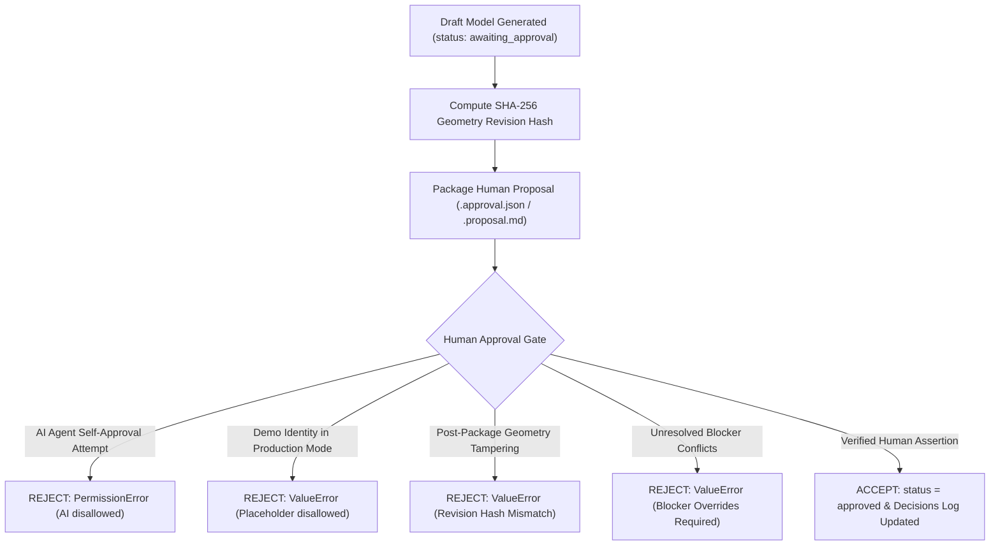

# Human Approval Security & Governance Reference

This reference details the security principles, revision tracking mechanics, identity assertion boundaries, and anti-tampering controls enforced by the Sketch-to-CAD Approval Gate.

---

## 1. Security Architecture & Threat Model



---

## 2. Core Security Invariants

### 1. Strict Prohibition of AI Agent Self-Approval
An AI agent or automated subprocess must **never** approve its own proposed floor-plan model.
- Disallowed identities: `agent`, `antigravity`, `ai`, `assistant`, `system`, `llm`, `bot`, `auto`, `self`, `automated`, `sketch-to-cad`.
- Attempting to approve using any of these tokens raises a `PermissionError`.

### 2. Prohibition of Placeholder / Demo Identities
In production mode (`allow_demo_identities=False`):
- Identities containing `Jane Doe`, `John Doe`, `Demo Reviewer`, `Placeholder`, `Sample User`, or `Test User` are rejected with a `ValueError`.
- A real, non-placeholder human reviewer identity is required.

### 3. Identity Assertion Boundary Notice
> [!IMPORTANT]
> **Authentication vs. Identity Assertion**:
> In a headless CLI or Python script environment, passing a reviewer name string (e.g. `reviewer_name="Dr. Aris Thorne, AIA"`) constitutes an **identity assertion**, NOT a cryptographic signature or multi-factor authentication.
> The approval record explicitly records `auth_method: "identity_assertion"` and `auth_security_level: "unverified_name_assertion"`.
> For municipal permit filings and legal architectural certifications, external digital signatures (PKI) or SSO tokens are strongly recommended.

### 4. Revision-Aware Geometry Invalidation (SHA-256)
The approval decision is tied cryptographically to a SHA-256 hash calculated over the model's structural geometry:
- Scope: `envelope`, `walls`, `openings`, `rooms`, `dimensions`, `staircases`, `columns`, `elements`, `levels`.
- Any material modification (e.g. changing envelope width, altering wall thickness, moving an opening) modifies the SHA-256 hash.
- If the current model hash differs from the reviewed package hash, the prior approval is immediately invalidated (`invalidated_by_revision`) and CAD drafting is blocked.

### 5. Auditable Decisions Log
All reviewer actions (`approve`, `reject`, `correct_dimension`, `correct_room_label`, `resolve_uncertainty`) are appended to `decisions_log` with an immutable UTC timestamp, reviewer assertion, and detailed action payload.

---

## 3. Headless Protocol Examples

### Human Approval Decision:
```json
{
  "reviewer_name": "Marcus Vance, Principal Architect (AIA #98214)",
  "action": "approve",
  "details": {
    "notes": "Approved for CAD drafting following visual and dimensional verification."
  }
}
```

### Reviewer Correction Decision:
```json
{
  "reviewer_name": "Marcus Vance, Principal Architect (AIA #98214)",
  "action": "correct_dimension",
  "details": {
    "target_id": "DIM-OVERALL-WIDTH",
    "new_value_mm": 8200.0
  }
}
```
*(Automatically updates the dimension, recalculates the geometry hash, resets package status to `awaiting_approval`, and logs the decision).*
