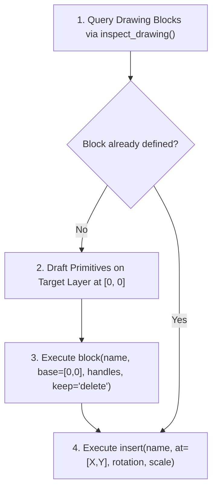

# Architectural Element Library Reference

> Specification for 2D residential architectural CAD blocks, fixture geometries, and floor-finish representations for `Sketch-to-CAD`.

---

## 1. Overview & Principles

The Architectural Element Library defines standardized, reusable 2D CAD blocks for residential floor-plan drawings. Instead of redrawing lines manually for every piece of furniture or plumbing fixture, the skill defines CAD blocks in model space and places block references (`insert`) at exact room coordinates.

### Mandatory Principles
1. **Configurable Defaults**: Default dimensions represent typical residential industry standards in millimeters (mm). They are starting points, **never** overrides of source sketch dimensions.
2. **Deterministic Insertion**: Every element has a defined origin `[0, 0]` base point (standardized at the bottom-left corner or centerline anchor), allowing rotation ($0^\circ, 90^\circ, 180^\circ, 270^\circ$) and non-colliding placement against host walls.
3. **AIA Layer Separation**:
   - `A-FURN`: Movable living, bedroom, and dining furniture.
   - `A-FIXT`: Fixed sanitary plumbing fixtures and built-in kitchen cabinetry.
   - `A-STAIR`: Staircase flights, steps, stringers, and walk-direction arrows.
   - `A-COLS`: Structural columns and load-bearing piers.
   - `A-FLOR-FIN`: Floor finish boundaries, tile grid hatches, and surface demarcations.
4. **Approval & Provenance Guard**:
   - Elements are flagged with provenance: `explicit` (sketched), `estimated` (scaled from sketch), `inferred` (architectural requirement like toilet in bath), or `proposed` (agent spatial layout).
   - `proposed` elements **require explicit human approval** before final CAD generation.

---

## 2. Element Catalog

### 2.1 Furniture (`A-FURN` / Color 3 - Green)

| Block ID | Description | Default Width (mm) | Default Depth (mm) | Base Point | Key Geometry Details |
| :--- | :--- | :---: | :---: | :---: | :--- |
| `FURN_BED_SINGLE` | Single bed | 1000 | 2000 | `[0, 0]` (BL) | Perimeter frame, single pillow (600×350mm), duvet fold line at $Y=1400$. |
| `FURN_BED_DOUBLE` | Double / Queen bed | 1800 | 2000 | `[0, 0]` (BL) | Perimeter frame, dual pillows (600×350mm each), duvet fold line at $Y=1400$. |
| `FURN_BEDSIDE_TABLE`| Bedside nightstand | 500 | 450 | `[0, 0]` (BL) | Outer cabinet rectangle, drawer front margin, drawer handle line. |
| `FURN_WARDROBE` | Bedroom wardrobe | 1800 | 600 | `[0, 0]` (BL) | Outer frame, 3 modular doors (600mm each), diagonal swing indicator lines. |
| `FURN_SOFA_2SEAT` | Two-seater sofa | 1500 | 850 | `[0, 0]` (BL) | Backrest (150mm depth), 2 side armrests (120mm width), 2 seating cushions. |
| `FURN_SOFA_3SEAT` | Three-seater sofa | 2100 | 850 | `[0, 0]` (BL) | Backrest (150mm depth), 2 side armrests (120mm width), 3 seating cushions. |
| `FURN_DINING_TABLE`| Dining table with chairs | 1500 | 900 | `[0, 0]` (BL) | Central table top (1500×900mm) flanked by 4 chair footprints (450×450mm). |
| `FURN_DESK` | Study desk with chair | 1200 | 600 | `[0, 0]` (BL) | Worktop rectangle, modesty panel, keyboard tray line, desk chair footprint. |
| `FURN_TV_UNIT` | Living room TV console | 1600 | 400 | `[0, 0]` (BL) | Media bench rectangle, low-profile TV screen footprint (1200×80mm). |

---

### 2.2 Sanitary Fixtures (`A-FIXT` / Color 8 - Dark Gray / Light Cyan)

| Block ID | Description | Default Width (mm) | Default Depth (mm) | Base Point | Key Geometry Details |
| :--- | :--- | :---: | :---: | :---: | :--- |
| `FIXT_TOILET` | Water closet / toilet | 450 | 700 | `[0, 0]` (BL) | Cistern tank (450×200mm back), elongated toilet bowl with rounded front arc. |
| `FIXT_WASHBASIN` | Vanity sink / basin | 600 | 450 | `[0, 0]` (BL) | Counter rectangle, inner oval basin rim, mixer tap / faucet circle. |
| `FIXT_SHOWER` | Shower enclosure | 900 | 900 | `[0, 0]` (BL) | Shower tray perimeter curb (50mm), diagonal slope drain lines, central drain. |
| `FIXT_BATHTUB` | Rectangular bathtub | 1700 | 750 | `[0, 0]` (BL) | Outer apron rectangle, rounded inner tub rim, drain outlet circle. |

---

### 2.3 Kitchen Fixtures (`A-FIXT` / Color 8 - Dark Gray)

| Block ID | Description | Default Width (mm) | Default Depth (mm) | Base Point | Key Geometry Details |
| :--- | :--- | :---: | :---: | :---: | :--- |
| `FIXT_KITCHEN_COUNTER` | Modular base counter | 1200 | 600 | `[0, 0]` (BL) | Counter surface (600mm depth standard), front bullnose edge line. |
| `FIXT_KITCHEN_SINK` | Double-bowl kitchen sink | 800 | 500 | `[0, 0]` (BL) | Outer rim rectangle, two interior wash basins, mixer faucet representation. |
| `FIXT_COOKING_HOB` | 4-burner cooktop / hob | 600 | 500 | `[0, 0]` (BL) | Outer hob frame, 4 circular burner rings with cross-grates. |
| `FIXT_REFRIGERATOR` | Refrigerator / freezer | 700 | 700 | `[0, 0]` (BL) | Refrigerator casing, door opening split line, door handle indication. |

---

### 2.4 Structural & Circulation Elements

| Block ID | Description | Default Width (mm) | Default Depth (mm) | Layer | Base Point | Key Geometry Details |
| :--- | :--- | :---: | :---: | :---: | :---: | :--- |
| `STRUC_COL_SQUARE` | Square structural column | 200 | 200 | `A-COLS` | `[0, 0]` (BL) | Solid perimeter box, diagonal cross lines indicating concrete core. |
| `STRUC_COL_RECT` | Rectangular column | 200 | 400 | `A-COLS` | `[0, 0]` (BL) | Solid rectangular perimeter with internal diagonal structural cross. |
| `CIRC_STAIR_STRAIGHT`| Straight staircase flight | 1000 | 2700 | `A-STAIR`| `[0, 0]` (BL) | 10 tread lines (270mm run each), side stringers, center walk line with UP arrow. |
| `CIRC_STAIR_LSHAPE` | L-shaped turning stair | 2000 | 2000 | `A-STAIR`| `[0, 0]` (BL) | Flight 1 (4 treads), 1000×1000mm quarter-landing, Flight 2 (4 treads), direction arrows. |

---

### 2.5 Floor Finishes & Tile Hatches (`A-FLOR-FIN` / Color 8)

Floor finishes represent wet-room tile demarcations, entrance mat wells, or balcony pavers:
- **`FIN_TILE_GRID`**: Generates a closed polyline boundary along room baseboards, hatched with AutoCAD pattern `ANSI37` or `NET` at configured scale (e.g., $300\text{ mm}$ or $600\text{ mm}$ grid spacing).
- **Rule of Restraint**: Hatching is applied **only** to wet areas (Bathrooms, Powder Rooms, Kitchens, Balconies) or when explicitly requested. Never fill general living or sleeping areas with dense linework unless specified by the client.

---

## 3. CADCraft MCP Block Workflow

CAD blocks are generated and reused in four deterministic steps:



### 3.1 Block Definition (`block`)
```python
execute(command="block", params={
    "name": "FURN_BED_DOUBLE",
    "base": [0.0, 0.0],
    "handles": ["101", "102", "103", "104"],
    "keep": "delete",
    "description": "Double bed 1800x2000mm with pillows"
})
```

### 3.2 Block Insertion (`insert`)
```python
execute(command="insert", params={
    "name": "FURN_BED_DOUBLE",
    "at": [2500.0, 4200.0],
    "rotation": 90.0,
    "scale": 1.0
})
```
- Rotations are specified in counter-clockwise degrees ($0^\circ, 90^\circ, 180^\circ, 270^\circ$).
- Scales default to `1.0`. Non-uniform scaling `[sx, sy]` may be used when adjusting custom-proportioned countertops or wardrobes.

---

## 4. Downstream BIM Semantic Mapping

When exported, CAD blocks on these layers translate directly into semantic BIMCraft elements:

| DXF Block ID / Layer | BIM Element Target | BIMCraft Parameter Source |
| :--- | :--- | :--- |
| `A-FURN` / `FURN_*` | Generic / Furniture Component | Block insertion $(X, Y)$, rotation, bounding dimensions |
| `A-FIXT` / `FIXT_*` | MEP / Plumbing & Kitchen Fixture | Block insertion $(X, Y)$, host room association |
| `A-STAIR` / `CIRC_STAIR_*` | BIMCraft `stair` | Riser count, run depth, width, storey association |
| `A-COLS` / `STRUC_COL_*` | BIMCraft `column` | Insertion point, cross-section profile, storey height |
| `A-FLOR-FIN` | BIMCraft `floor` finish layer | Room boundary boundary polygon, finish thickness (15-25mm) |
