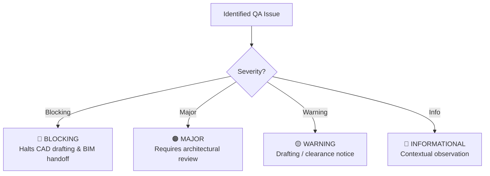

# Architectural & Engineering QA Framework

This document outlines the multi-tier architectural quality assurance and engineering validation framework implemented by `scripts/architectural_qa.py`.

---

## 1. Multi-Tier Severity Model

Architectural discrepancies, drafting errors, and geometric violations are categorized into four deterministic severity tiers:



### 1.1 Severity Tier Definitions

| Severity | Color & Icon | Drafting Action | Downstream Impact | Examples |
| :--- | :--- | :--- | :--- | :--- |
| **`blocking`** | 🔴 BLOCKING | Halts drafting immediately; raises error | Disallows DXF export and BIM handoff | Degenerate walls ($L < 10\text{ mm}$), overlapping openings, self-intersecting rooms, unapproved model status |
| **`major`** | 🟠 MAJOR | Flags `MAJOR_DISCREPANCY` status | Mandates explicit human review | Room boundary outside envelope, missing host wall reference in opening, walls $< 50\text{ mm}$ |
| **`warning`** | 🟡 WARNING | Flags `REVIEW_REQUIRED` status | Documented in audit report | Corner clearance $< 50\text{ mm}$, door swing conflicts, unintended wall gap ($35\text{--}250\text{ mm}$), out-of-scale sketch |
| **`informational`**| 🔵 INFO | Normal completion (`PASSED`) | Logged for completeness | Free-standing partition stub, duplicate dimension strings |

---

## 2. Companion BIM Handoff Integrity

Every generated CAD drawing is paired with a versioned structured JSON contract (`bim-handoff.schema.json`) for consumption by downstream 3D BIM skills (`dxf-to-3d-bim`). The QA framework validates:

1. **Referential Integrity**: Every door and window opening must reference a valid `wallId` present in the wall definitions.
2. **Coordinate Homology**: 2D floor coordinates match the CAD drawing geometry in `Cartesian2D_RightHanded_YUp`.
3. **Null Preservation**: Unannotated 3D heights remain strictly `null` (never fabricated or guessed from 2D views).
4. **Unique Entity Identifiers**: All walls, rooms, openings, and elements have unique IDs.

---

## 3. Engineering Audit Report Format

The QA validator renders an itemized Markdown report suitable for human sign-off:

```markdown
# Architectural & Engineering QA Audit Report: Villa Sunset Residence

## Executive Summary
- **Drawing / Output:** `villa_sunset_ground.dxf`
- **Target Level:** `LEVEL-01`
- **Overall Audit Status:** **REVIEW_REQUIRED**
- **Total Issues Cataloged:** 2

## Severity Breakdown
- **Blocking:** 0
- **Major:** 0
- **Warning:** 2
- **Informational:** 0

## Itemized Audit Findings

| Issue ID | Severity | Category | Description | Affected Entities | Suggested Action | Approval Req? |
| :--- | :--- | :--- | :--- | :--- | :--- | :---: |
| `QA-OPEN-001` | 🟡 WARNING | `openings` | Corner clearance: opening 'D-01' within 50mm of wall corner. | `D-01, W-01` | Shift opening 50mm inward. | Yes |
```

---

## 4. Human Approval Governance

> [!CAUTION]
> **Approval Integrity Policy**:
> 1. No automated repair algorithm may alter room boundary coordinates, wall thicknesses, or opening dimensions without human approval.
> 2. An unapproved model (`status: "awaiting_approval"`) is strictly rejected by `DrawingGenerator.validate_preflight`.
> 3. Resolving a `blocking` or `major` issue requires updating the structured floor-plan model and obtaining human sign-off before CAD re-generation.
