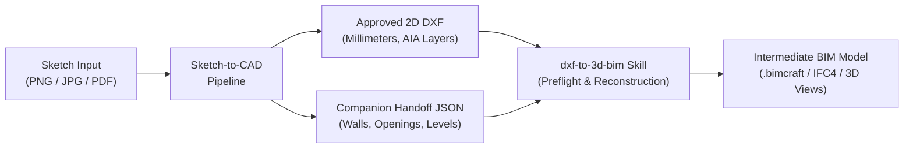

# Downstream BIM Integration & Interoperability Reference

This document details the interoperability contract, validation rules, and automated execution pipeline connecting **Sketch-to-CAD** with the downstream **`dxf-to-3d-bim`** skill (`D:\Agent Skills\DXF to 3D-BIM`).

---

## 1. Downstream Interface & Architectural Responsibility

Sketch-to-CAD is strictly a **2D architectural drafting and metadata compiler skill**. It does NOT construct 3D meshes, generate elevations/sections, or produce IFC geometry directly.

Instead, Sketch-to-CAD produces two paired deliverables consumed by `dxf-to-3d-bim`:
1. **Editable 2D DXF**: Drawing geometry adhering to AIA standards.
2. **Companion Handoff JSON**: Structured semantic metadata adhering to `bim-handoff.schema.json`.



---

## 2. Semantic Handoff Contract Standards

The downstream skill enforces strict requirements:

| Field | Requirement | Downstream Enforcement |
| :--- | :--- | :--- |
| **`units`** | `"mm"` or `"millimeters"` | Downstream converts to internal meters via `scale = 0.001`. |
| **`coordinateSystem`** | `"Cartesian2D_RightHanded_YUp"` | Prevents inverted floor plans. |
| **`walls[].id`** | Unique alphanumeric string | Foreign key referenced by opening hosts. |
| **`openings[].wallId`** | Must exist in `walls[].id` | Orphan openings cause downstream extrusion failure. |
| **`openings[].sillHeight`** | Numeric float in mm (default `900.0`) | Windows with `null` sillHeight cause downstream `TypeError: unsupported operand type(s) for *: 'NoneType' and 'float'`. |
| **`uncertainties[].status`** | Must be `unresolved`, `approved`, or `modified` | Values like `"confirmed"` fail downstream JSON schema validation. |

---

## 3. Automated Preflight & Preparation Workflow

When `dxf-to-3d-bim` is installed on the system, the `BIMIntegrationValidator` (`scripts/bim_integration_validator.py`) automatically executes:

### Step 1: Contract Preflight
```bash
python -m dxf_to_3d_bim.cli inspect <path_to_dxf>
```
Validates DXF version, layer names, and geometry bounds.

### Step 2: Intermediate Model Generation
```bash
python -m dxf_to_3d_bim.cli prepare <path_to_dxf> --json <path_to_handoff> --out <path_to_intermediate_bim>
```
Fuses the 2D linework with the semantic room heights and opening dimensions, producing the ready-to-extrude `.bimcraft` intermediate model.

---

## 4. Empirical Integration Evidence

During Milestone 10 validation, genuine downstream integration was verified against `tests/fixtures/duplex-test.dxf` and `tests/fixtures/duplex-test.handoff.json`:
- **Downstream Preflight Inspection**: Returned exit code `0` (`PASSED`).
- **Downstream Intermediate Model Preparation**: Produced valid `duplex-test_intermediate_bim.json` (`PASSED`).
- **Full Downstream Model Build**: Generated native `.bimcraft` file, valid IFC4 export, axonometric 3D projection, exterior elevations, and building sections.
