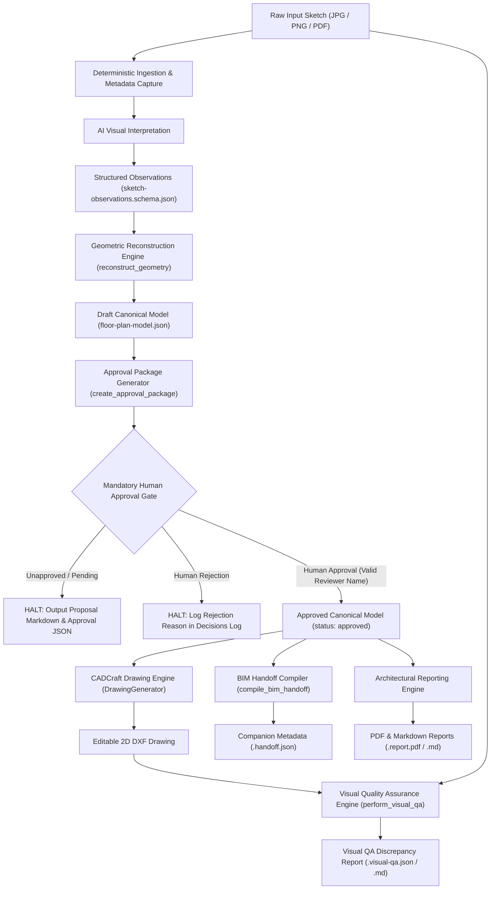

# End-to-End Sketch-to-CAD Pipeline

This reference documents the complete architectural and operational lifecycle of the Sketch-to-CAD pipeline, from raw hand-drawn sketch input to production CAD deliverables, structured BIM metadata, and comprehensive architectural reports.

---

## 1. Pipeline Architecture Diagram



---

## 2. The 10 Pipeline Stages

### Stage 1: Ingestion & Input Normalization
- Accepts `.jpg`, `.jpeg`, `.png`, and `.pdf` files.
- Extracts dimensions, DPI, page count, and orientation without mutating source files.
- Rejects empty, corrupted, or unsupported formats with actionable error messages.

### Stage 2: AI Visual Interpretation
- Extracts walls, openings, rooms, stairs, columns, and dimensions.
- Tags every entity with its source bounding box `[ymin, xmin, ymax, xmax]`.

### Stage 3: Structured Observation Validation
- Validates observations against `sketch-observations.schema.json`.
- Enforces data integrity before geometry reconstruction.

### Stage 4: Geometric Reconstruction & Contradiction Detection
- Validates wall connectivity (flags dangling walls).
- Orthogonally aligns walls within $\pm 5^\circ$; **strictly preserves genuinely angled walls**.
- Detects arithmetic contradictions (e.g., room chain sum exceeding overall envelope) and creates blocker review issues instead of silently distorting walls.

### Stage 5: Draft Canonical Model Compilation
- Assembles a canonical model conforming to `floor-plan-model.json`.
- Status is strictly set to `"awaiting_approval"`.

### Stage 6: Approval Package Creation
- Calculates deterministic SHA-256 revision hash of model geometry.
- Generates `<project>.approval.json` and human-readable `<project>.proposal.md`.

### Stage 7: Mandatory Human Approval Gate
- **Strict Prohibition**: AI agents, assistants, and automated bots are strictly prohibited from self-approving.
- **Revision Invalidation**: Any geometry modification made after package creation invalidates the revision hash, requiring renewed approval.
- **Decision Actions**:
  - `approve`: Applies approval, sets `approved_by` and timestamp, transitions model status to `"approved"`.
  - `reject`: Records rejection reason, halts CAD drafting.
  - `correct_dimension`: Updates target dimension, recalculates revision hash, updates package.
  - `correct_room_label`: Updates room name, recalculates revision hash.

### Stage 8: CADCraft DXF Generation
- Generates editable 2D DXF drawings conforming to AIA CAD layer standards (`A-WALL-EXTR`, `A-WALL-INTR`, `A-DOOR`, `A-GLAZ`, `A-FLOR-LEVL`, `A-FLOR-PATT`, `A-ANNO-DIMS`, `A-ANNO-TEXT`, etc.).
- Registers reusable CAD block references for architectural elements (furniture, sanitary, kitchen).

### Stage 9: BIM Handoff & Architectural Reporting
- Compiles standardized companion `<project>.handoff.json` for downstream 3D BIM generation.
- Generates professional architectural reports (`.report.pdf` and `.report.md`) containing area schedules, element inventories, and uncertainty audits.

### Stage 10: Source-to-CAD Visual Quality Assurance
- Compares source sketch features against generated CAD drawing.
- Evaluates footprint aspect ratio, room topology, opening counts, and dimension fidelity.
- Generates `<project>.visual-qa.json` and `<project>.visual-qa.md` discrepancy reports.

---

## 3. Python API & Headless Review Usage

```python
from scripts.sketch_to_cad_pipeline import SketchToCADPipeline

pipeline = SketchToCADPipeline()

# 1. First Run: Generates proposal and pauses at approval gate
draft_res = pipeline.run_pipeline(
    source_sketch_path="sketches/floor-plan.jpg",
    output_dir="output/project_01",
    approval_decision=None,
    project_name="Maple Residence",
)
print(draft_res["status"])  # "awaiting_approval"
print(draft_res["proposal_path"])  # "output/project_01/maple-residence.proposal.md"

# 2. Human Reviewer Approves Proposal
human_decision = {
    "reviewer_name": "Marcus Aurelius, AIA",
    "action": "approve",
    "details": {"notes": "Approved for CAD drafting."},
}

approved_res = pipeline.run_pipeline(
    source_sketch_path="sketches/floor-plan.jpg",
    output_dir="output/project_01",
    approval_decision=human_decision,
    project_name="Maple Residence",
)
print(approved_res["status"])  # "completed"
print(approved_res["dxf_path"])  # "output/project_01/maple-residence.dxf"
print(approved_res["report_pdf_path"])  # "output/project_01/maple-residence.report.pdf"
print(approved_res["visual_qa_status"])  # "MATCH"
```

