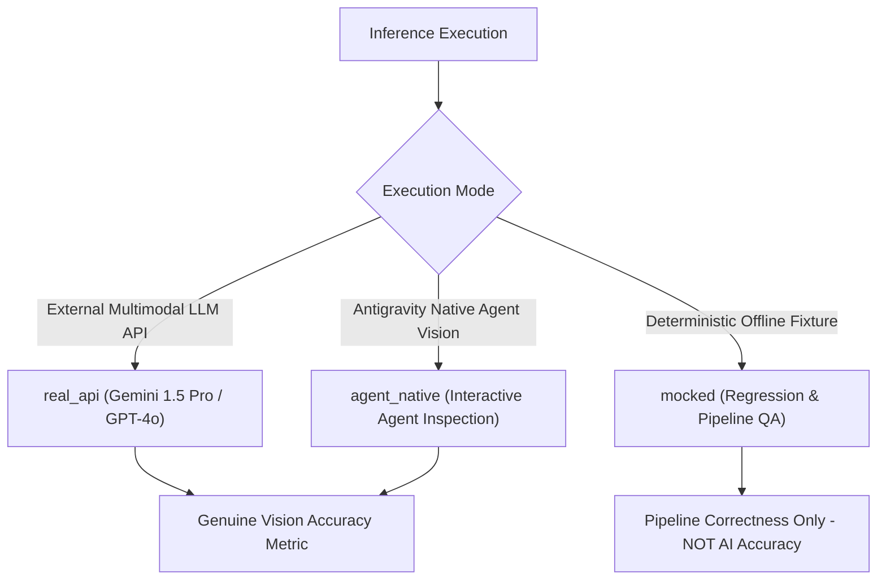

# Independent Benchmark Methodology & Accuracy Evaluation (Milestone 12)

This document establishes the formal mathematical and algorithmic methodology for evaluating Sketch-to-CAD vision observations and reconstructed floor-plan models against independent architectural ground truth.

---

## 1. Provenance Integrity & Execution Modalities

To maintain scientific integrity and prevent misleading representations, Sketch-to-CAD strictly partitions all benchmark execution records into three mutually exclusive modalities:



### 1.1 Modality Definitions
1. **`real_api`**:
   - Model inference performed via live authenticated HTTP requests to multimodal vision APIs (Google Gemini, OpenAI).
   - Requires live API keys (`GEMINI_API_KEY`, `OPENAI_API_KEY`).
   - Latencies, token counts, and raw provider payloads are recorded verbatim in the execution record.
2. **`agent_native`**:
   - Observations extracted through interactive multimodal vision inspection by the Antigravity agent or user-assisted bridge.
   - Applied to authentic field sketches such as `PILOT-02` (`sample-b-rough-sketch.jpg`).
   - Represents verified real AI multimodal interpretation.
3. **`mocked`**:
   - Deterministic offline baseline execution using pre-supplied test fixtures or synthetic test drawings.
   - Used strictly to verify evaluation framework mathematics, bipartite matching algorithms, schema compliance, and release packaging gates.
   - **MANDATORY POLICY**: Mock benchmark scores must NEVER be cited or advertised as genuine AI vision model accuracy.

---

## 2. Spatial Bipartite Matching Algorithms

Architectural plans cannot be evaluated with simple textual or coordinate equality because hand sketches inherently contain drawing jitter, minor scaling variations, and non-standard orientations. The benchmark engine applies spatial bipartite matching across four distinct architectural tiers.

### 2.1 Wall Matching
Let $P = \{p_1, p_2, \dots, p_m\}$ be predicted walls and $G = \{g_1, g_2, \dots, g_n\}$ be ground truth walls.
Each wall is represented by endpoints $s$ and $e$, and thickness $t$.
A predicted wall $p_i$ matches a ground-truth wall $g_j$ if:
$$\min\Big( \|s_{p_i} - s_{g_j}\| + \|e_{p_i} - e_{g_j}\|,\; \|s_{p_i} - e_{g_j}\| + \|e_{p_i} - s_{g_j}\| \Big) \le 2 \cdot \tau_{\text{wall}}$$
where $\tau_{\text{wall}} = 300\text{ mm}$.
Matching is solved greedily using minimum endpoint error distance.
- **Metrics Computed**:
  $$\text{Precision} = \frac{|TP|}{|TP| + |FP|}, \quad \text{Recall} = \frac{|TP|}{|TP| + |FN|}, \quad F_1 = \frac{2 \cdot \text{Precision} \cdot \text{Recall}}{\text{Precision} + \text{Recall}}$$
  $$\text{Mean Endpoint Error} = \frac{1}{|TP|} \sum_{k \in TP} \text{error}_k \quad (\text{mm})$$

### 2.2 Opening Matching (Doors & Windows)
Openings are characterized by center coordinate $c$, width $w$, host wall $W_{\text{id}}$, and subtype (hinged, sliding, casement, etc.).
A predicted opening matches a ground truth opening if:
$$\|c_{\text{pred}} - c_{\text{gt}}\| \le \tau_{\text{opening}} \quad (\tau_{\text{opening}} = 300\text{ mm})$$
and the opening types are compatible (e.g. door vs door, window vs window).
- **Metrics Computed**:
  - Position Error: $\|c_{\text{pred}} - c_{\text{gt}}\|$ (mm).
  - Width Error: $|w_{\text{pred}} - w_{\text{gt}}|$ (mm).
  - Subtype Classification Accuracy: percentage of matched openings where subtype matches exactly.

### 2.3 Room Polygon Matching (Intersection over Union)
Let $A_{\text{pred}}$ be the predicted room polygon and $A_{\text{gt}}$ be the ground truth room polygon.
The spatial overlap is evaluated using Intersection over Union (IoU):
$$\text{IoU}(A_{\text{pred}}, A_{\text{gt}}) = \frac{\text{Area}(A_{\text{pred}} \cap A_{\text{gt}})}{\text{Area}(A_{\text{pred}} \cup A_{\text{gt}})}$$
A predicted room is considered a True Positive if $\text{IoU} \ge 0.50$.
- **Metrics Computed**:
  - Mean Room IoU across all rooms.
  - Net Area Error Percentage:
    $$\Delta\text{Area}\% = \frac{|\text{Area}_{\text{pred}} - \text{Area}_{\text{gt}}|}{\text{Area}_{\text{gt}}} \times 100\%$$
  - Label Classification Accuracy: functional room label match (e.g. "BEDROOM" vs "BED").

### 2.4 Dimension Value Matching
Let $v_{\text{pred}}$ be an extracted numerical dimension and $v_{\text{gt}}$ be the corresponding ground-truth dimension string.
A dimension is numerically correct if:
$$|v_{\text{pred}} - v_{\text{gt}}| \le \tau_{\text{dim}} \quad (\tau_{\text{dim}} = 50\text{ mm})$$
- **Metrics Computed**:
  - Numeric Accuracy: percentage of annotated dimensions extracted within $50\text{ mm}$.
  - Mean Value Error: average absolute millimeter discrepancy on matched dimensions.

---

## 3. Uncertainty & Contradiction Capture Rate

A critical quality requirement for architectural AI is the ability to detect and flag anomalies rather than making silent assumptions. The benchmark evaluator tracks:
$$\text{Uncertainty Capture Rate} = \frac{\text{Detected Ground Truth Uncertainties}}{\text{Total Expected Uncertainties}} \times 100\%$$

Expected uncertainties evaluated in the pilot suite:
1. **Arithmetic Dimension Contradictions** (`PILOT-02`, `PILOT-05`):
   - Internal room chains that do not sum to the overall exterior building dimension.
2. **Unclosed Perimeter Loops** (`PILOT-04`):
   - Missing wall segments that leave habitable spaces open to the exterior.
3. **Hardware Skew & Rotation** (`PILOT-06`, `PILOT-07`):
   - Non-orthogonal drawing rotations exceeding standard drafting tolerances.
4. **Low Image Signal-to-Noise Ratio** (`PILOT-08`):
   - Faint graphite or JPEG compression blur requiring surveyor confirmation.
5. **Unannotated Vertical Parameters** (`PILOT-16`):
   - Windows lacking explicit sill height callouts, triggering explicit assumption provenance.

---

## 4. Benchmark Execution & Reporting Pipeline

The benchmark suite is executed via:
```bash
python scripts/pilot_benchmark_runner.py
```
This automatically produces two coordinated audit artifacts:
1. **`pilot_benchmark_report.json`**:
   - Machine-readable dataset containing full per-sample and per-category metrics, SHA-256 hashes, timestamps, and execution modality tags.
2. **`pilot_benchmark_report.md`**:
   - Executive audit report with category comparison tables, highlighted provenance disclosures, and sample-level architectural findings.
