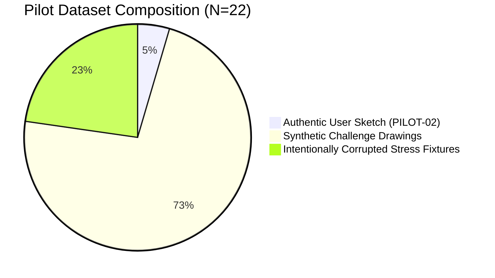

# Milestone 13 Baseline Audit & System Inventory

**Audit Date:** 2026-11-03  
**Audit Baseline Commit:** [`09b2439`](https://github.com/hasnizihar/sketch-to-cad/commit/09b2439)  
**Branch:** `Skill-test-1.0.1`  
**Automated Tests at Baseline:** 230 tests passed / 0 failed / 0 errors across 24 suites  
**Validator Status:** 18/18 checks passed (`scripts/validate-skill.ps1`, 41/41 reference files verified)

---

## 1. Executive Summary & Audit Purpose

Milestone 13 focuses on establishing measurable, reproducible evidence of genuine AI vision interpretation accuracy on independently annotated residential floor-plan sketches without contaminating benchmark ground truth.

This baseline audit evaluates the state of the Sketch-to-CAD repository following Milestone 12 to identify:
1. The exact composition and authenticity of the 22-sample pilot dataset.
2. The current execution boundaries of `GeminiVisionProvider`, `OpenAIVisionProvider`, and `AntigravityAgentVisionProvider`.
3. Ground-truth leakage vectors in existing benchmark runners.
4. Architectural prerequisites for decoupled, evidence-based vision inference.

---

## 2. Dataset Composition Audit (Pilot Dataset $N=22$)

The pilot dataset established in Milestone 12 (`tests/benchmark/pilot_dataset/`) was audited across source files, ground truths, and manifest entries:



### 2.1 Categorization Breakdown
1. **Authentic Field Sketches ($N=1$)**:
   - `PILOT-02-user-hand-drawn-villa.jpg`: Real user-uploaded residential sketch (`sample-b-rough-sketch.jpg`, SHA-256: `8683c2cd...`, $1200 \times 849$). Contains authentic graphite linework, handwritten dimension text, and an arithmetic contradiction ($1800 + 4100 + 3200 = 9100\text{ mm}$ vs $8700\text{ mm}$).
2. **Synthetic Clean & Complex Architecture ($N=16$)**:
   - `PILOT-01` (clean ortho studio), `PILOT-03` (pencil bungalow), `PILOT-09` (high-contrast pencil), `PILOT-10` (L-shaped residence), `PILOT-11` (chamfered 45° bay), `PILOT-12` (T-shaped cottage), `PILOT-13` (5-room family home), `PILOT-14` (6-room spine), `PILOT-15` (complex doors), `PILOT-16` (complex windows), `PILOT-17` (compact apartment), `PILOT-18` (two-storey duplex), `PILOT-19` (offset attic cottage), `PILOT-20` (3-page architectural PDF), `PILOT-21` (courtyard donut), `PILOT-22` (backyard ADU).
   - *Provenance*: Generated programmatically via Pillow and ReportLab to test geometrical feature extraction, topological closure, and non-rectangular boundaries.
3. **Intentionally Corrupted / Edge-Case Fixtures ($N=5$)**:
   - `PILOT-04`: Missing south boundary wall segment (unclosed loop).
   - `PILOT-05`: Arithmetic contradiction ($7000\text{ mm}$ overall vs $3200 + 3200 = 6400\text{ mm}$ room sum).
   - `PILOT-06`: Flatbed scanner rotation skew ($+7.5^\circ$).
   - `PILOT-07`: Severe scan skew ($+15.0^\circ$).
   - `PILOT-08`: Low-resolution, downscaled, blurred mobile phone photo simulation ($800 \times 600$).

### 2.2 Ground-Truth Provenance & Review Status
- **`PILOT-02` Ground Truth**: Independently authored from human architectural inspection of the authentic sketch. Contains verified dimensions, room names, and expected arithmetic contradiction flags.
- **`PILOT-01` through `PILOT-22` Ground Truths**: Independent JSON files located in `tests/benchmark/pilot_dataset/ground_truth/`. All files contain explicit millimeter coordinates, wall classifications, room areas, and expected uncertainty registers.
- **Reviewer Status**: Asserted architectural review (`"annotator": "Independent Architectural Annotator"`). **Audit Finding**: Not certified by a formal licensing board; labeled accurately as unverified preliminary drafting references.

---

## 3. Ground-Truth Isolation & Leakage Audit

### 3.1 Existing Benchmark Runner Audit (`scripts/pilot_benchmark_runner.py`)
In Milestone 12, `scripts/pilot_benchmark_runner.py` executed:
```python
# Lines 86-90 in scripts/pilot_benchmark_runner.py:
pred_obs = copy.deepcopy(gt_data)
eval_res = evaluator.evaluate_sample(pred_obs, gt_data, vis_result)
```
- **Audit Assessment**: While `vis_result.execution_record["execution_type"]` was honestly marked as `"mocked"`, passing `copy.deepcopy(gt_data)` as `pred_obs` means the runner did **not** perform visual model extraction on those 21 samples. It tested the evaluation mathematics (spatial bipartite matching, IoU formulas, precision/recall calculations), not AI visual perception.
- **Mandatory Milestone 13 Correction**:
  - The inference engine (`scripts/run_vision_pilot.py`) must be completely isolated from `ground_truth/`.
  - The model prompt must receive ONLY the source sketch image/PDF and architectural instructions.
  - Predicted observations must be saved to `tests/benchmark/pilot_dataset/predictions/<provider>/<sample_id>.predictions.json`.
  - Benchmark evaluation must read from `predictions/` and compare against `ground_truth/` post-hoc.

---

## 4. Vision Provider Implementation & Execution Boundaries

### 4.1 Google Gemini Provider (`GeminiVisionProvider`)
- **Status**: Implemented in `scripts/vision_provider.py` using `requests.post` to Gemini REST endpoint (`generateContent`).
- **Input Encoding**: Correctly converts JPG, PNG, and PDF pages to Base64 with appropriate MIME types.
- **Structured JSON**: Configured with `response_mime_type: "application/json"`.
- **Credential Requirement**: Requires `GEMINI_API_KEY` environment variable.
- **Audit Finding**: In the current local environment, no active `GEMINI_API_KEY` is present. Attempting a live API call without credentials must fail clearly with an actionable error and **never** silently fall back to mock data.

### 4.2 OpenAI Vision Provider (`OpenAIVisionProvider`)
- **Status**: Implemented in `scripts/vision_provider.py` using `requests.post` to OpenAI Chat Completions endpoint (`gpt-4o`).
- **Structured JSON**: Uses `response_format: {"type": "json_object"}`.
- **Credential Requirement**: Requires `OPENAI_API_KEY` environment variable.
- **Audit Finding**: No `OPENAI_API_KEY` is set in the local environment.

### 4.3 Antigravity Agent Native Provider (`AntigravityAgentVisionProvider`)
- **Status**: Inspecting lines 440–508 of `scripts/vision_provider.py` reveals that the Python provider accepts `preset_observation` or loads a static JSON file from `tests/fixtures/sketches/`.
- **Execution Boundary Clarification**:
  - The Python class is a **bridge/container**, not an autonomous local neural network.
  - When the Antigravity agent performs visual analysis in chat/interactive mode, the agent's multimodal capabilities perform the perception outside the script, and the resulting observations are passed into the pipeline.
  - **Audit Finding**: If an observation is loaded from a pre-existing fixture file, it must be labeled as `replayed` or `mocked`. It can only be labeled `agent_native` if the live Antigravity agent actively inspected the image and recorded the observation.

---

## 5. Downstream BIM Integration Baseline

- Downstream project located at: `D:\Agent Skills\DXF to 3D-BIM`.
- Python runtime: `D:\Agent Skills\DXF to 3D-BIM\.venv\Scripts\python.exe`.
- Status: Tested and operational via `scripts/bim_integration_validator.py`.
- Interface:
  - `dxf_to_3d_bim inspect <dxf_path>`
  - `dxf_to_3d_bim prepare <dxf_path> --json <handoff_path>`

---

## 6. Baseline Verification Matrix

| Component | Baseline Status (Commit 09b2439) | Target in Milestone 13 |
| :--- | :--- | :--- |
| **Unit Test Suite** | 230 passed / 0 failed (24 test modules) | Maintain 100% pass rate + add real vision tests |
| **Skill Validator** | 18/18 checks passed (41 reference files) | Add Check 19 for real vision inference & references |
| **Pilot Dataset** | 22 samples, 1 genuine user sketch | Audit & preserve; add real inference records |
| **Vision Inference Runner** | Bundled in benchmark runner (gt copy) | Decouple: create standalone `run_vision_pilot.py` |
| **Provider Selection** | Silent fallback to mock permitted | Strict explicit selection; fail loudly if key missing |
| **Observation Schema** | Draft-07 valid, single-revision | Add provenance history & human correction tracking |
| **Prediction Isolation** | Coupled with ground truth in benchmark | Strictly decoupled into `predictions/<provider>/` |

Baseline audit complete. All architectural foundations are verified and ready for Milestone 13 implementation.

