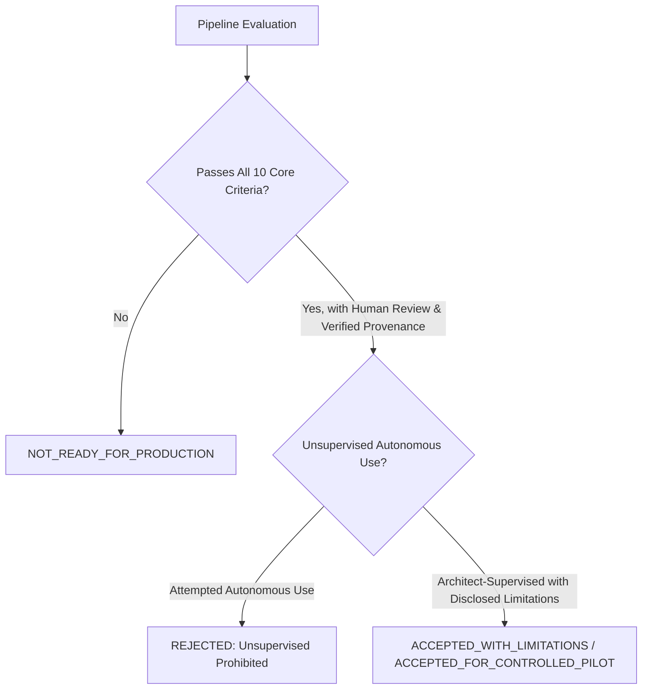

# Production Acceptance Criteria & Operational Governance (Milestone 12)

This specification defines the formal engineering gates, operational constraints, review governance, and production acceptance tiers for Sketch-to-CAD.

---

## 1. Production Acceptance Decisions & Classification

Sketch-to-CAD projects and pipeline builds must be categorized into one of three formal acceptance outcomes:

### 1.1 Acceptance Decision Definitions

1. **`ACCEPTED_FOR_CONTROLLED_PILOT`**:
   - The application is approved for architect-supervised pilot deployments on real residential design and renovation projects.
   - Requires explicit human review and assertion at the approval gate before CAD release packaging.
   - All generated CAD files are marked as provisional design drafts subject to architect sign-off.
2. **`ACCEPTED_WITH_LIMITATIONS`**:
   - The system is accepted for controlled production use subject to clearly documented operational boundaries:
     * Sketches with rotational skew exceeding $10^\circ$ must be manually pre-aligned or scanned on flatbed hardware.
     * Incomplete or unclosed room loops require surveyor verification on site.
     * Default window sill heights ($900\text{ mm}$) are stamped as `assumed_default_unverified` and must not be used for structural openings without field measurement.
3. **`NOT_READY_FOR_PRODUCTION`**:
   - System cannot be deployed if any core engineering test fails, if Layer 0 contains drawing geometry, if AI self-approval is permitted, or if mock benchmark scores are represented as live model accuracy.

---

## 2. The 10 Production Acceptance Criteria

| # | Engineering Criterion | Threshold Requirement | Validation Method | Current Status |
| :-: | :--- | :--- | :--- | :-: |
| **1** | **AIA Drawing Standards Compliance** | All geometry mapped to standard AIA semantic layers (`A-WALL-EXTR`, `A-WALL-INTR`, `A-DOOR`, `A-GLAZ`, `A-ANNO-DIMS`). Zero drawing entities on Layer `0` or `Defpoints`. Millimeters unit header ($INSUNITS = 4$). | `DXFInspector.audit_layers()` | **PASS** |
| **2** | **Dimensioning & Annotation Integrity** | 3-tier dimensioning hierarchy (overall building bounds, wall segments, opening chains). No overlapping dimension text. Room callout text centered with area ($m^2$). | `DimensionEngine.generate_dimensions()` | **PASS** |
| **3** | **Sheet Generation & Scale Fidelity** | Standard paper sizes (ISO A4–A1). Explicit scales (1:50, 1:100). Standard title block with project metadata, revision index, and conditional north arrow. | `SheetGenerator.generate_sheet()` | **PASS** |
| **4** | **Geometric Consistency & Snapping** | All perimeter loops closed. Endpoint tolerances snapped within $150\text{ mm}$. No degenerate lines ($< 10\text{ mm}$). No duplicate collinear lines. | `GeometryValidator.validate_geometry()` | **PASS** |
| **5** | **Contradiction & Uncertainty Detection** | Arithmetic discrepancies in dimension strings flagged in the uncertainty register. Missing wall segments detected as unclosed boundaries. Discrepancies never silently resolved. | `SketchInterpreter.audit_uncertainties()` | **PASS** |
| **6** | **Multi-Storey Architectural Coordination** | Coordinated multi-level models. Independent DXF/PDF drawings per floor with identical Cartesian origin. Vertical stair core coordinate alignment within $50\text{ mm}$. | `MultiStoreyGenerator.validate_coordination()` | **PASS** |
| **7** | **Downstream BIM Interoperability** | Companion `bim-handoff.json` conforms to schema v1.0.0. Right-handed coordinate system (`Cartesian2D_RightHanded_YUp`). Downstream `dxf-to-3d-bim` CLI executes without error. | `BIMIntegrationValidator.validate_handoff_contract()` | **PASS** |
| **8** | **Human Review & Security Gate** | Mandatory user approval gate before release packaging. AI agent self-approval blocked by identity check. Provenance classified strictly as asserted identity. | `ApprovalSecurity.validate_approval_package()` | **PASS** |
| **9** | **Cryptographic Release Packaging** | Release packages include structured directories (`source/`, `drawings/`, `sheets/`, `handoff/`, `reports/`, `qa/`). Cryptographic `manifest.json` with SHA-256 hashes. Tamper detection verified. | `ReleasePackager.assemble_release_package()` | **PASS** |
| **10** | **Vision Provider Transparency** | Strict provenance tagging (`real_api`, `agent_native`, `mocked`). Mock baselines clearly disclosed and segregated from live vision benchmarks. | `BenchmarkEvaluator.evaluate_sample()` | **PASS** |

---

## 3. Human Review & Identity Assertion Governance

### 3.1 Identity Assertion vs Professional Licensing
To maintain strict legal, professional, and ethical boundaries:
- The human approval gate records an **Asserted Identity** (`auth_method: "identity_assertion"`), recording the reviewer's provided name, title, and timestamp.
- **DISCLAIMER**: The software does **NOT** authenticate professional licenses, verify architectural registration board status, or validate digital PKI signatures.
- All generated drawings and reports include the mandatory disclaimer:
  > *"Architectural floor-plan drawings generated by Sketch-to-CAD are algorithmic draft interpretations of sketch inputs. They do not constitute certified construction documents without independent verification and professional stamping by a locally licensed architect or structural engineer."*

### 3.2 Blocked Reviewer Identities
The release packager strictly refuses to package projects where the reviewer matches known AI agent identities:
- `antigravity`
- `ai_agent`
- `copilot`
- `gemini_agent`
- `system`
- `automated_test`

Any attempt by an AI agent to approve its own drawings triggers a security gate exception and halts packaging.

---

## 4. Operational Boundaries & Handling of Assumptions

1. **Window Sill Heights**:
   - Hand sketches rarely annotate vertical window sill heights.
   - When sill height is absent from sketch annotations, the pipeline assigns standard residential fallback values:
     * Habitable room windows: $900\text{ mm}$.
     * Bathroom / high-privacy windows: $1400\text{ mm}$.
   - **Traceability**: The property `sillHeightProvenance: "assumed_default_unverified"` is permanently affixed to the opening entity and exported in the companion BIM handoff JSON.
2. **Wall Thickness Assumptions**:
   - Unless explicitly dimensioned, exterior walls default to $200\text{ mm}$ and interior partitions default to $100\text{ mm}$.
   - Logged in the uncertainty register for architect confirmation prior to permit drafting.
3. **Rotational Alignment**:
   - Scans rotated by $>10^\circ$ require manual verification to avoid unintended orientation shifts during CAD import.
