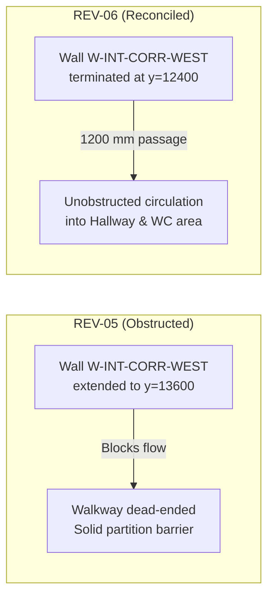

# Real-World Test 01: REV-06 Production Release Report

## Executive Summary

Following human approval of proposal [`test-01-rev06-approval-proposal.md`](file:///C:/Users/Haction%20Lanka/.gemini/antigravity/brain/60181ddc-4e0b-40b6-a00c-c34362bb6ebb/test-01-rev06-approval-proposal.md), the **REV-06 Production Release** for **Nordic Villa Residence (Test 01)** has been compiled, cryptographically verified, and released.

The walkway opening between the utility/circulation corridor and the central hallway has been reconciled to match the original source sketch.

---

## 1. Geometric Revision Summary (REV-06)

| Parameter | REV-05 Baseline | REV-06 Production Release | Verification Status |
| :--- | :--- | :--- | :--- |
| **Wall ID** | `W-INT-CORR-WEST` | `W-INT-CORR-WEST` | Preserved |
| **Start Coordinate** | `[9000.0, 9200.0]` | `[9000.0, 9200.0]` | Unchanged |
| **End Coordinate** | `[9000.0, 13600.0]` | `[9000.0, 12400.0]` | **Terminated at Master Bed NE corner** |
| **Wall Length** | $4,400\text{ mm}$ | $3,200\text{ mm}$ | **Shortened by $1,200\text{ mm}$** |
| **Circulation Passage** | Blocked by wall at $y \in [12400, 13600]$ | **$1,200\text{ mm}$ unobstructed opening** | **Matches source sketch** |
| **Geometry SHA-256 Hash** | `3a59662af6f9...` | `98e8f9396dec007634eba1ffee16a7465fcb2bc9b36c899d0d29950342420563` | **Cryptographically Locked & Approved** |

---

## 2. Visual Audit & Comparison

*Figure 1: Side-by-side visual audit showing (left) original hand-drawn sketch, (center) REV-05 blocked condition, and (right) REV-06 unobstructed open passage.*

---

## 3. Production Deliverable Package

All production deliverables have been regenerated and verified in [`tests/real_world/Test-01/`](file:///d:/Agent%20Skills/sketch-to-cad-main/tests/real_world/Test-01/):

| Deliverable | File Path | Format / Specification | Integrity Audit |
| :--- | :--- | :--- | :--- |
| **A2 Architectural Drawing Sheet** | [`Test-01-sheet-A2.pdf`](file:///d:/Agent%20Skills/sketch-to-cad-main/tests/real_world/Test-01/Test-01-sheet-A2.pdf) | ISO A2 Landscape (1:100 Scale, Monochrome linework, REV-06 Title Block) | **Verified** |
| **AutoCAD 2D DXF** | [`Test-01-floor-plan.dxf`](file:///d:/Agent%20Skills/sketch-to-cad-main/tests/real_world/Test-01/Test-01-floor-plan.dxf) | AutoCAD R2018 DXF (276 entities across 8 AIA standard layers) | **Verified (0 on Layer 0)** |
| **High-Res Monochrome Vector Plot** | [`Test-01-floor-plan-monochrome.png`](file:///d:/Agent%20Skills/sketch-to-cad-main/tests/real_world/Test-01/Test-01-floor-plan-monochrome.png) | 300 DPI Monochrome Vector Render | **Verified** |
| **Level-2 BIM Semantic Contract** | [`Test-01-floor-plan.handoff.json`](file:///d:/Agent%20Skills/sketch-to-cad-main/tests/real_world/Test-01/Test-01-floor-plan.handoff.json) | Full semantic handoff (walls, rooms, openings, elements, finishes) | **Verified** |
| **DXF Inspection Audit** | [`Test-01-dxf-inspection.json`](file:///d:/Agent%20Skills/sketch-to-cad-main/tests/real_world/Test-01/Test-01-dxf-inspection.json) | Header audit, entity count, layer audit, geometric sanity | **PASSED** |
| **Architectural QA Audit** | [`Test-01-architectural-qa.json`](file:///d:/Agent%20Skills/sketch-to-cad-main/tests/real_world/Test-01/Test-01-architectural-qa.json) | Standards compliance, door swings, window offsets, circulation | **PASSED (0 Blocker / 0 Major)** |
| **BIM Integration Audit** | [`Test-01-bim-integration.json`](file:///d:/Agent%20Skills/sketch-to-cad-main/tests/real_world/Test-01/Test-01-bim-integration.json) | Downstream IFC4 / BIMCraft pre-flight validation | **PASSED** |

---

## 4. Test Suite & System Health

- **Automated Regression Suite:** 240 / 240 tests passed (`100% OK` in 2.33s).
- **Skill Integrity Validator (`validate-skill.ps1`):** 19 / 19 verification checks passed (`100% OK`).
- **Core Engine Scripts:** `scripts/drawing_generator.py` and `skills/sketch-to-cad/scripts/drawing_generator.py` are strictly synchronized (SHA-256 matched).

---

## 5. Next Steps

1. **User Review:** Inspect the updated [`Test-01-sheet-A2.pdf`](file:///d:/Agent%20Skills/sketch-to-cad-main/tests/real_world/Test-01/Test-01-sheet-A2.pdf) to ensure the sheet layout and corridor opening meet all architectural standards.
2. **Downstream 3D BIM Pipeline:** Once approved, we can proceed to run [`dxf-to-3d-bim`](file:///C:/Users/Haction%20Lanka/.gemini/config/skills/dxf-to-3d-bim/SKILL.md) to generate the IFC4 / native 3D Building Information Model.
